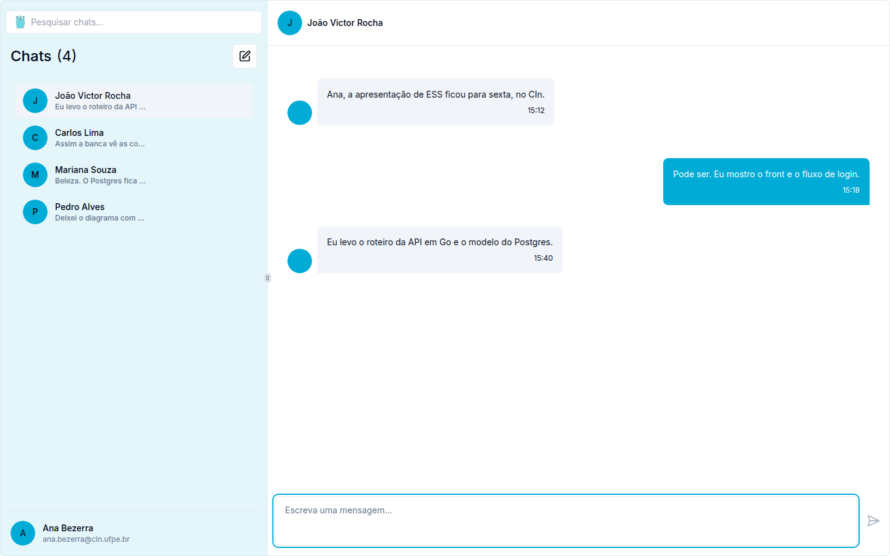
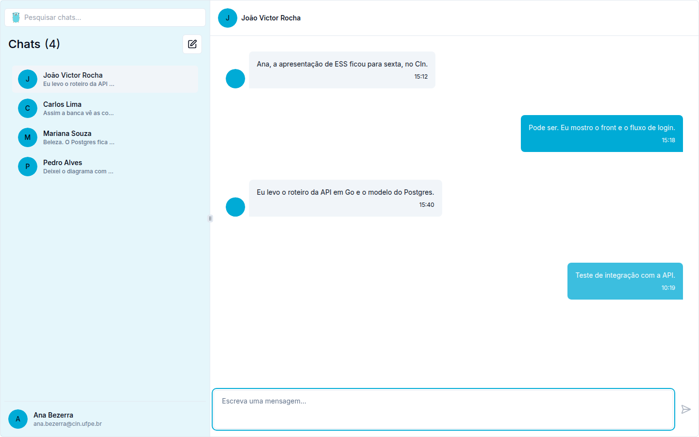
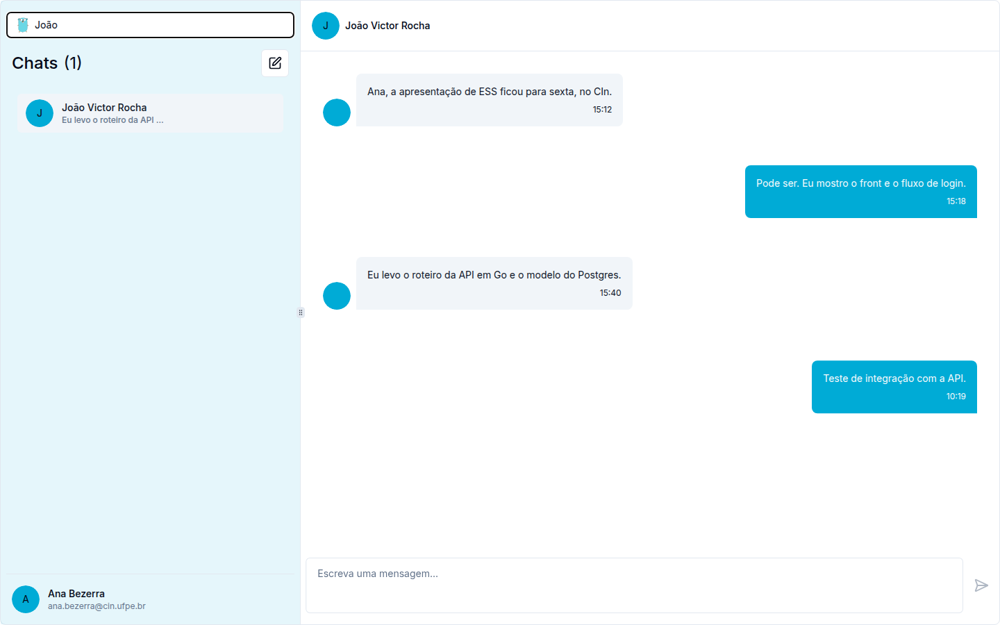
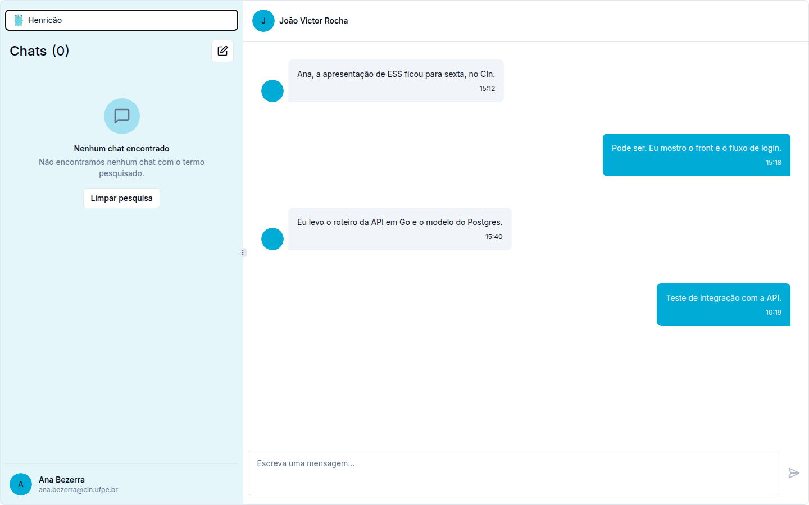
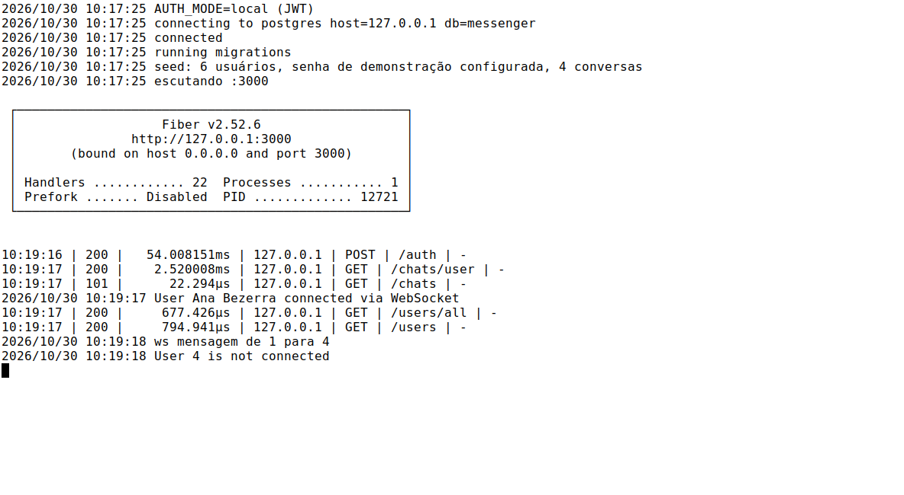

# go-messenger

[](https://go.dev/)
[](https://docs.gofiber.io/)
[](https://gorm.io/)

API HTTP em Go para o mensageiro. O processo sobe com [Fiber](https://docs.gofiber.io/) na porta 3000, guarda usuários e conversas no PostgreSQL e entrega mensagem em tempo real por WebSocket. O front-end que consome estes caminhos é [go-messager-ui](https://github.com/iianmelo/go-messager-ui).

O histórico de chats, grupos e socket veio do repositório da equipe, [Mlcarvalho1/go-messenger](https://github.com/Mlcarvalho1/go-messenger) (`master`, `5fbdc0c`). Este fork acrescenta o modo local: `AUTH_MODE=local` emite um JWT e sobe sem conta de serviço do Firebase.

## Sumário

- [Funcionalidades](#funcionalidades)
- [Arquitetura](#arquitetura)
- [Como funciona](#como-funciona)
- [Demonstração](#demonstração)
- [Como executar](#como-executar)
- [Testes](#testes)
- [Estrutura do repositório](#estrutura-do-repositório)
- [Estado atual](#estado-atual)
- [Ligações](#ligações)

## Funcionalidades

`AUTH_MODE` vazio ou `local` usa senha com bcrypt e JWT HS256 (`JWT_SECRET`). `AUTH_MODE=firebase` mantém o Identity Toolkit e o Admin SDK.

| Método | Caminho | Autenticação | Comportamento |
| --- | --- | --- | --- |
| `POST` | `/auth` | não | Lê `email` e `password`. No modo local devolve `{"token","user"}`. No Firebase devolve `{"token"}` com o ID token. |
| `POST` | `/auth/sign-up` | não | Lê `name`, `email`, `password` e `photo_url`. Cria o usuário. |
| `POST` | `/resetpassword` | não | Lê `email`. No modo local responde 200 sem enviar carta. No Firebase gera o link e usa o SendGrid. |
| `GET` | `/chats/user` | `Bearer` | Conversas da pessoa, com `user`, `receiver` e `messages`. |
| `GET` | `/chats` | `?token=` | WebSocket. O quadro é `{"text","receiverId"}`. |
| `GET` | `/users` | `Bearer` | Perfil: `id`, `name`, `email`, `avatar`. |
| `PATCH` | `/users` | `Bearer` | Atualiza `name` e `photo`. |
| `GET` | `/users/all` | `Bearer` | Contatos, sem a própria pessoa. |
| `GET` | `/groups/user/:userId` | `Bearer` | Chats de grupo. O front atual não chama esta rota. |
| `POST` | `/groups` | `Bearer` | Cria grupo. |
| `GET` | `/debug` | não | Ecoa o header `Authorization`. |

Códigos que o login e o middleware devolvem no modo local:

| Situação | Status | Corpo |
| --- | --- | --- |
| JSON inválido em `/auth` | 400 | `Invalid request body` |
| E-mail ou senha vazios | 400 | `Email and password are required` |
| E-mail desconhecido ou senha errada | 401 | `Invalid email or password` |
| Header `Authorization` ausente | 401 | `Authorization header missing` |
| JWT recusado | 401 | `Invalid or expired token` |

A pesquisa por nome acontece no navegador, sobre a lista de `GET /chats/user`. Não há query `?q=` no servidor.

Na primeira subida com a tabela `users` vazia, e com `SEED` diferente de `false`, o processo grava seis pessoas e quatro conversas em português. A senha de todas é `senha123`.

| Nome | E-mail |
| --- | --- |
| Ana Bezerra | ana.bezerra@cin.ufpe.br |
| Carlos Lima | carlos.lima@cin.ufpe.br |
| Mariana Souza | mariana.souza@cin.ufpe.br |
| João Victor Rocha | joao.rocha@cin.ufpe.br |
| Pedro Alves | pedro.alves@cin.ufpe.br |
| Beatriz Nunes | beatriz.nunes@cin.ufpe.br |

Beatriz entra só na lista de contatos. As conversas de Ana estão com João, Carlos, Mariana e Pedro, nesta ordem de mensagem mais recente.

## Arquitetura

<p align="center">
  
</p>

Fonte editável: [`docs/arquitetura.puml`](docs/arquitetura.puml).

Na subida, `main` faz o seguinte:

1. `godotenv.Load()` no `init`. Sem `.env`, segue e registra `No .env file found`.
2. Se `AUTH_MODE=firebase`, abre o cliente Admin. No modo local esse passo não roda.
3. `database.ConnectDb()` abre o PostgreSQL, migra `User`, `Chat`, `Group` e `GroupMember` e, se a tabela estiver vazia, semeia a demonstração.
4. Registra as rotas, inclusive o CORS, e escuta em `:3000`.

O log de conexão cita host e nome do banco. A senha não é impressa.

## Como funciona

<p align="center">
  
</p>

Fonte: [`docs/sequencia-login-usuario.puml`](docs/sequencia-login-usuario.puml).

O JWT leva o identificador `local-<id>` no claim `uid`. O middleware e o socket gravam esse valor em `Locals` e acham a linha por `fire_token`. A senha fica só no bcrypt, com `json:"-"`.

O quadro do socket é acrescentado ao JSON da conversa. Se ainda não existir conversa entre as duas pessoas, o servidor cria. O texto segue para o socket do destinatário quando ele está ligado. Quem envia vê a própria mensagem na hora, pelo estado do front.

## Demonstração

Front em `http://127.0.0.1:8080` com `NEXT_PUBLIC_API_URL=http://127.0.0.1:3000` e `NEXT_PUBLIC_WS_URL=ws://127.0.0.1:3000/chats`. Conta `ana.bezerra@cin.ufpe.br`, senha `senha123`. Capturas de 30 de outubro de 2026, por volta das 7h19 no horário de Recife, em 1440×900.

<p align="center">
  
</p>

<p align="center">
  
</p>

<p align="center">
  
</p>

<p align="center">
  
</p>

<p align="center">
  
</p>

O `101` em `GET /chats` é a troca para WebSocket. A linha `ws mensagem de 1 para 4` é Ana falando com João. João não estava com o socket aberto, então o processo registra que o usuário 4 não está conectado; a mensagem fica gravada na conversa.

## Como executar

É preciso Go 1.22.3 e um PostgreSQL que aceite a DSN de `database/database.go`.

```sql
CREATE USER messenger WITH PASSWORD 'senha';
CREATE DATABASE messenger OWNER messenger;
```

```bash
cp .env.example .env
go run app.go
```

O `.env` precisa estar no diretório de trabalho. O exemplo já deixa `AUTH_MODE=local`.

Com Docker, a partir da raiz:

```bash
docker compose up --build
```

O compose sobe o Postgres 16 e a API na porta 3000, com a semente ligada.

O front, no modo API:

```bash
NEXT_PUBLIC_API_URL=http://127.0.0.1:3000
NEXT_PUBLIC_WS_URL=ws://127.0.0.1:3000/chats
```

Sem `NEXT_PUBLIC_API_URL` o front continua na demonstração local e não chama esta API. O README de `go-messager-ui` ainda descreve a API como só Firebase. A frase a acrescentar lá é: o modo local usa as duas variáveis acima e a conta `ana.bezerra@cin.ufpe.br` / `senha123`.

```bash
curl -s -H 'Content-Type: application/json' \
  -d '{"email":"ana.bezerra@cin.ufpe.br","password":"senha123"}' \
  http://127.0.0.1:3000/auth

curl -s -H "Authorization: Bearer SEU_TOKEN" \
  http://127.0.0.1:3000/chats/user
```

## Testes

```bash
go test ./tests/api
```

O pacote cobre login, perfil, contatos, ordem da lista, cadastro com lista vazia, troca de senha no modo local, atualização de perfil e a gravação da mensagem que chega pelo WebSocket. Usa o banco `messenger_test` em `127.0.0.1`.

`make test-integration` só roda com `RUN_FIREBASE_TESTS=1`. Esses arquivos batem no Identity Toolkit e ficam de fora do `go test ./...` comum.

Os `.feature` continuam a especificação de tela. Não há `godog`: os cenários falam de página, ícone e botão, e a pesquisa e a lista vazia são texto do front (`Nenhum chat encontrado`, `Nenhuma conversa ainda`). O ícone de falha de rede e o reenvio descritos em `features/messages.feature` não têm ramo no socket.

## Estrutura do repositório

```text
go-messenger/
├── app.go
├── config/                 AUTH_MODE e segredo do JWT
├── controllers/
├── database/               conexão, migração e semente
├── features/               Gherkin, sem runner
├── middlewares/
├── models/
├── routes/
├── services/
├── tests/api/              testes do modo local
├── tests/integration/      testes antigos, só com Firebase
├── webSockets/
├── docker-compose.yml
├── Dockerfile
└── docs/
```

## Estado atual

- A lista do front ordena pelo horário da última mensagem. A semente grava João por último na conversa mais nova, então ele abre primeiro.
- `GET /groups/user/:userId` e `POST /groups` existem por causa do upstream. A tela de chats deste front é só conversa entre duas pessoas.
- No modo local, `POST /resetpassword` confirma o pedido e não manda e-mail.
- O front desenha a mensagem enviada na hora. Se o socket cair antes do `send`, o balão continua na tela e o servidor não recebe o texto. Não há ícone de erro nem botão de reenvio.

## Ligações

- Este repositório: [github.com/iianmelo/go-messenger](https://github.com/iianmelo/go-messenger)
- Upstream: [github.com/Mlcarvalho1/go-messenger](https://github.com/Mlcarvalho1/go-messenger)
- Front-end: [github.com/iianmelo/go-messager-ui](https://github.com/iianmelo/go-messager-ui)
- [Fiber](https://docs.gofiber.io/)
- [GORM](https://gorm.io/docs/)
