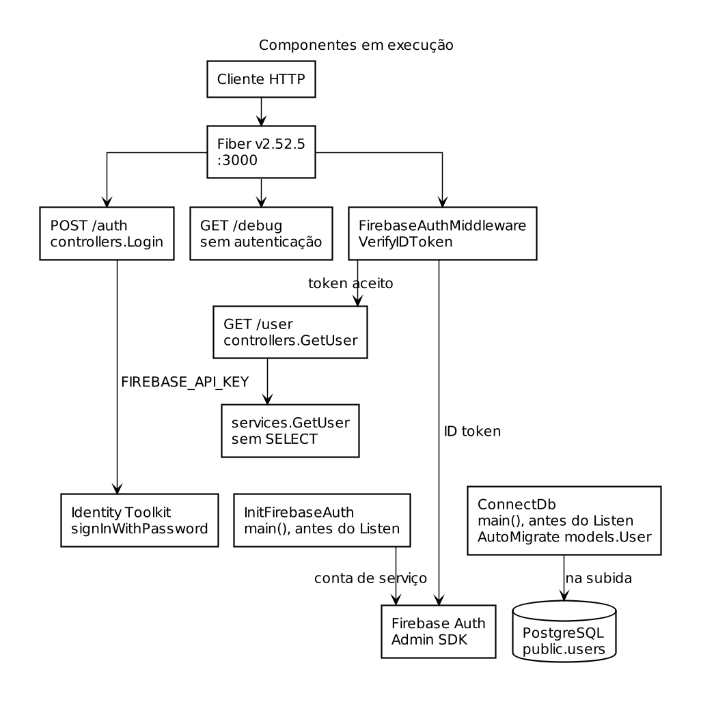
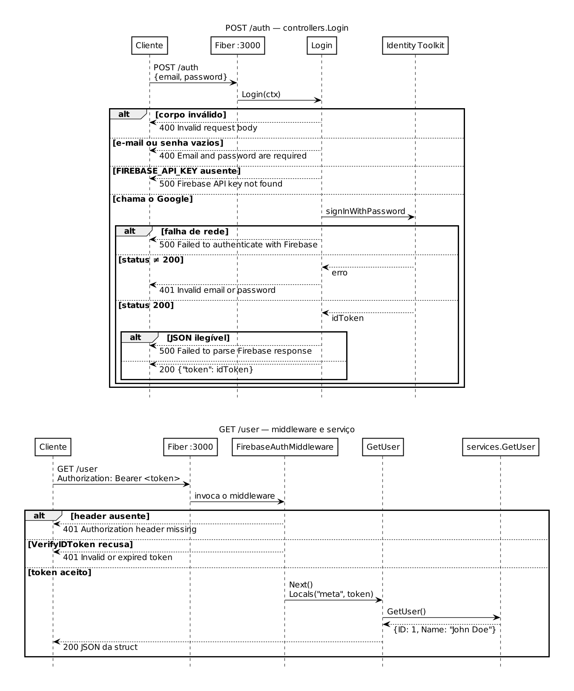
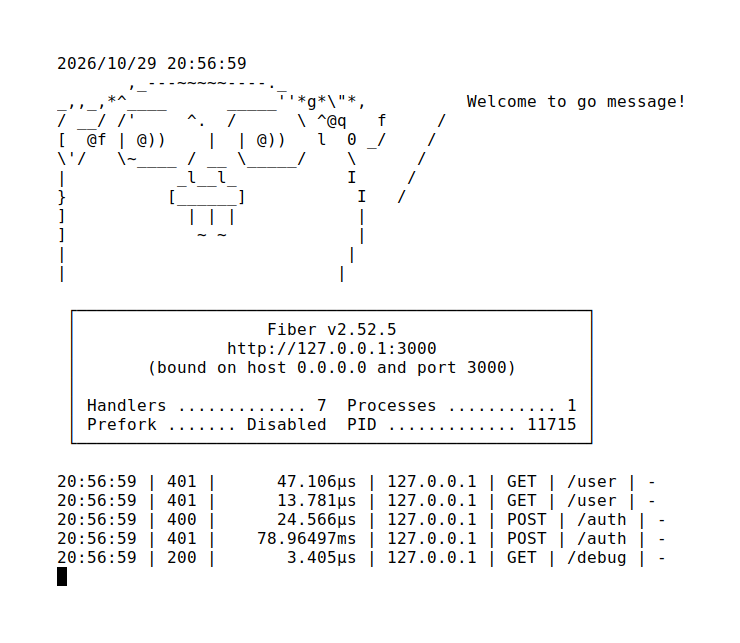
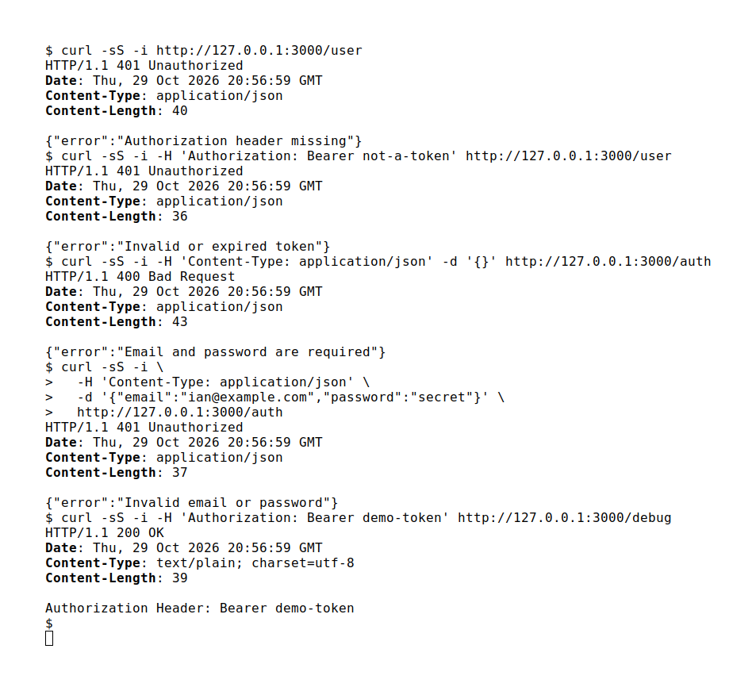

# go-messenger

[](https://go.dev/)
[](https://docs.gofiber.io/)
[](https://gorm.io/)
[](https://firebase.google.com/docs/auth)

API HTTP em Go para a autenticação de um mensageiro. O processo sobe com [Fiber](https://docs.gofiber.io/) na porta 3000, troca e-mail e senha por um ID token do Firebase e cria a tabela `users` no PostgreSQL. O envio, o recebimento, a listagem e a pesquisa de chats estão escritos em Gherkin e ainda não têm rota neste servidor.

## Sumário

- [Contexto](#contexto)
- [Funcionalidades](#funcionalidades)
- [Arquitetura](#arquitetura)
- [Como funciona](#como-funciona)
- [Demonstração](#demonstração)
- [Como executar](#como-executar)
- [Estrutura do repositório](#estrutura-do-repositório)
- [Estado atual](#estado-atual)
- [Aprendizados](#aprendizados)
- [Ligações](#ligações)

## Contexto

Repositório de Ian Medeiros Melo (`iianmelo`). No git, os commits dele estão assinados como Ian Melo, com o e-mail `imm2@cin.ufpe.br`. A implementação está em 15 commits, de 5 a 20 de dezembro de 2024.

Nesses commits aparecem dois autores:

- Manoel Lira de Carvalho (`Mlcarvalho1`) escreveu a estrutura HTTP, o desenho do gopher em `app.go`, o Firebase Auth, o PostgreSQL e os cenários de mensagem privada, mensagem em grupo e recebimento.
- Ian Melo, em 15 de dezembro de 2024, adicionou `features/listagem_chats.feature` e `features/pesquisa_chats.feature` e fez o merge do pull request #1, vindo de `Mlcarvalho1/features`.

Não há neste repositório lista de equipe, período letivo, nota ou métrica de uso. Os merges citam `Mlcarvalho1/go-messenger`; esse repositório continua público. Este README não trata os dois como o mesmo remoto.

O repositório relacionado [go-messager-ui](https://github.com/iianmelo/go-messager-ui) se apresenta, no README dele, como base de front-end em Next.js da disciplina de Engenharia de Software e Sistemas do Centro de Informática (CIn) da UFPE. Essa frase não está nos arquivos daqui. Os cenários de listagem e de pesquisa de lá repetem os que foram commitados aqui, com edições posteriores. Na `main` daquele repositório, o formulário de login não dispara requisição e o `baseURL` do Playwright está comentado. Nada neste código chama o front-end, nem o contrário.

## Funcionalidades

### O que o processo executa

| Método | Caminho | Autenticação | Comportamento |
| --- | --- | --- | --- |
| `POST` | `/auth` e `/auth/` | não | Lê `email` e `password`. Pede um ID token ao Identity Toolkit. Devolve `{"token":"..."}` se o Google responder 200. |
| `GET` | `/user` | `Authorization: Bearer` | Se o ID token for aceito, devolve o usuário fixo de `services.GetUser`. |
| `GET` | `/debug` | não | Devolve o header `Authorization` em texto puro. |
| na subida | — | conta de serviço | `AutoMigrate` de `models.User` no PostgreSQL. |

Códigos que o `Login` e o middleware devolvem, lidos do código e conferidos na execução local onde dá para chegar sem um projeto Firebase:

| Situação | Status | Corpo |
| --- | --- | --- |
| JSON inválido em `/auth` | 400 | `Invalid request body` |
| E-mail ou senha vazios | 400 | `Email and password are required` |
| `FIREBASE_API_KEY` ausente | 500 | `Firebase API key not found` |
| Falha de rede até o Google | 500 | `Failed to authenticate with Firebase` |
| Identity Toolkit responde algo que não é 200 | 401 | `Invalid email or password` |
| Header `Authorization` ausente em rota protegida | 401 | `Authorization header missing` |
| `VerifyIDToken` recusa o token | 401 | `Invalid or expired token` |

Na execução de 29 de outubro de 2026 saíram o 400, os 401 e o 200 de `/debug`. O 200 de `/auth` e o 200 de `/user` dependem de um projeto Firebase real e não foram vistos.

`GET /` também caiu no middleware e respondeu 401. A rota não tem handler próprio: o que não é registrado antes do `Use` passa pela verificação do token.

### O que está só nos arquivos `.feature`

Não há `godog` nem outro runner no `go.mod`. São especificações, não testes que rodam.

| Arquivo | Feature | Cenários | Commit |
| --- | --- | --- | --- |
| `features/messages.feature` | Envio de mensagem privada | sucesso, falha de rede, reenvio | Manoel Lira de Carvalho |
| `features/groupMessages.feature` | Envio em grupo | sucesso, falha de rede com ícone de erro | Manoel Lira de Carvalho |
| `features/messageReceive.feature` | Recebimento | contato ou grupo, dentro e fora do chat, não lida / lida | Manoel Lira de Carvalho |
| `features/listagem_chats.feature` | Lista de chats | lista com itens na ordem da mensagem mais recente, lista vazia, abrir um chat | Ian Melo |
| `features/pesquisa_chats.feature` | Pesquisa por nome | com correspondência e sem correspondência (`"não foram encontrados chats"`) | Ian Melo |

Não existe tabela de mensagem, de chat ou de grupo. Não existe WebSocket, fila ou fan-out.

## Arquitetura

O código separa rota, controller, serviço, modelo e banco. Não há camada de view: a resposta é JSON ou texto. O nome MVC do README antigo descreve essa pasta, não uma interface renderizada no servidor.

<p align="center">
  
</p>

<p align="center"><em>Componentes que o processo liga. <code>services.GetUser</code> não se conecta ao PostgreSQL: esse serviço não faz SELECT.</em></p>

Fonte editável: [`docs/arquitetura.puml`](docs/arquitetura.puml).

Na subida, `main` faz três coisas, nesta ordem:

1. `godotenv.Load()` no `init`. Se não houver `.env`, segue e registra `No .env file found`.
2. `database.InitFirebaseAuth()`, que lê `SERVICE_ACCOUNT_JSON` e abre o cliente Admin do Firebase. Sem essa variável o processo encerra.
3. `database.ConnectDb()`, que abre o PostgreSQL e roda `AutoMigrate` de `models.User`. Se a conexão falha, o processo encerra.

Depois registra as rotas e escuta em `:3000`.

Protocolos usados pelo código da aplicação:

- HTTP/1.1, JSON, atendido pelo Fiber 2.52.5 (fasthttp).
- HTTPS de saída para `https://identitytoolkit.googleapis.com/v1/accounts:signInWithPassword`.
- Verificação do ID token pelo Admin SDK do Firebase Auth.
- PostgreSQL, pelo driver pgx do GORM.

Não há goroutine, canal nem mutex no código da aplicação. Quem atende requisições em paralelo é o servidor Fiber. Não há concorrência de entrega de mensagem porque essa entrega não foi implementada.

O modelo persistido é só `models.User`: `gorm.Model` mais `ID`, `Name`, `Email` (`uint`) e `FireToken`. Na primeira subida contra um PostgreSQL 16.15 vazio, o `AutoMigrate` criou `public.users` com `email` do tipo `bigint`.

## Como funciona

O fluxo abaixo é o que está em `controllers/auth.go`, `middlewares/firebaseAuth.go`, `controllers/user.go` e `services/user.go`. Não é o fluxo de chat dos arquivos `.feature`.

<p align="center">
  
</p>

<p align="center"><em>Sequência implementada. A de baixo não passa pelo PostgreSQL.</em></p>

Fonte: [`docs/sequencia-login-usuario.puml`](docs/sequencia-login-usuario.puml).

`POST /auth` monta a URL do Identity Toolkit com `FIREBASE_API_KEY` e envia `email`, `password` e `returnSecureToken`. Qualquer status que não seja 200 vira o mesmo 401, `Invalid email or password`, sem repassar o corpo do Google. O middleware, nas rotas protegidas, tira um prefixo `Bearer ` se ele existir e chama `VerifyIDToken`. O token aceito fica em `c.Locals("meta")`. `GetUser` não lê esse valor.

`services.GetUser` devolve sempre `ID` 1 e `Name` `"John Doe"`, com erro nulo. O ramo 404 de `controllers.GetUser` não roda com esse serviço.

`middlewares/firebase.go` define `FirebaseMiddleware`, que guardaria um `*firebase.App` no contexto. Nenhuma rota o usa. O que está ligado é `FirebaseAuthMiddleware`.

## Demonstração

Execução local em 29 de outubro de 2026: PostgreSQL 16.15 em `127.0.0.1:5432`, `.env` na raiz e um JSON de conta de serviço só para o processo abrir o cliente Admin. Não havia projeto Firebase nem usuário real. A senha do banco aparece no log de subida (`ConnectDb` imprime o DSN) e foi cortada destas figuras.

<p align="center">
  
</p>

<p align="center"><em>Processo no ar. O <code>POST /auth</code> que chegou ao Google levou cerca de 79 ms. As recusas locais ficaram na casa dos microssegundos.</em></p>

<p align="center">
  
</p>

<p align="center"><em>As mesmas cinco chamadas, do lado do cliente. O 200 de <code>/user</code> não entra porque falta um ID token válido.</em></p>

## Como executar

O ponto de entrada é `app.go`. `go run main.go` não acha arquivo.

É preciso Go 1.22.3 (versão do `go.mod`) e um PostgreSQL que aceite a DSN montada em `database/database.go`:

```text
host=... user=... password=... dbname=... port=...
```

Não há `sslmode` nessa string. Contra um PostgreSQL local com autenticação por senha, a conexão funcionou sem esse parâmetro.

```sql
CREATE USER messenger WITH PASSWORD 'senha';
CREATE DATABASE messenger OWNER messenger;
```

No console do Firebase, baixe o JSON da conta de serviço e guarde-o fora do git (o nome `serviceAccountKey.json` já está no `.gitignore`). A chave Web do mesmo projeto vai em `FIREBASE_API_KEY`. Sem um projeto real, o processo sobe e as rotas de erro respondem; o login não emite token.

```bash
cp .env.example .env
# edite DB_PASSWORD, FIREBASE_API_KEY e SERVICE_ACCOUNT_JSON

go run app.go
```

O `.env` precisa estar no diretório de trabalho, porque o `godotenv` lê `./.env`.

```bash
curl -i http://127.0.0.1:3000/user

curl -i -H 'Content-Type: application/json' \
  -d '{"email":"voce@exemplo.com","password":"senha"}' \
  http://127.0.0.1:3000/auth

curl -i -H "Authorization: Bearer SEU_ID_TOKEN" \
  http://127.0.0.1:3000/user
```

## Estrutura do repositório

```text
go-messenger/
├── app.go                         entrada: Fiber, Firebase, Postgres, :3000
├── controllers/
│   ├── auth.go                    POST /auth → Identity Toolkit
│   └── user.go                    GET /user
├── database/
│   ├── database.go                GORM e AutoMigrate
│   └── firebaseConfig.go          cliente Admin do Firebase Auth
├── features/                      cenários Gherkin, sem runner
├── middlewares/
│   ├── firebase.go                não usado pelas rotas
│   └── firebaseAuth.go            VerifyIDToken
├── models/user.go
├── routes/
├── services/user.go               usuário fixo, sem SELECT
├── docs/                          diagramas PlantUML e capturas
├── .env.example
└── README.md
```

## Estado atual

Coisas visíveis no código, para não ler o diagrama como se o chat já existisse:

- `services.GetUser` não lê nem grava `users`. A tabela nasce na subida e o handler não a consulta.
- `Email` é `uint`. A coluna migrada foi `bigint`, não texto.
- A struct declara `ID` e também embute `gorm.Model`, que tem outro `ID`. Um `json.Marshal` da struct devolvida pelo serviço produz os dois, `ID` 0 e `id` 1. Isso não foi capturado no HTTP.
- `ConnectDb` imprime a DSN, com a senha, via `print`, sem quebra de linha antes do log seguinte.
- `GET /debug` ecoa o header `Authorization` e não passa pelo middleware.
- Login, middleware e serviço não registram mensagem, chat, grupo, leitura nem reenvio. Esses fluxos param nos `.feature`.

## Aprendizados

O que o repositório deixa verificar, sem nota e sem métrica inventada:

- Especificação e servidor estão separados de propósito ou por estágio. Os `.feature` descrevem o produto de chat; o binário que escuta cobre conta e token.
- A senha não é coluna do Postgres. Ela sai na chamada ao Identity Toolkit. O que o middleware confere depois é o ID token, com a conta de serviço.
- `AutoMigrate` acompanha o tipo Go. `Email uint` virou `bigint` na tabela criada.
- Dois repositórios podem repetir o mesmo cenário de lista e de pesquisa e ainda não se falar por HTTP. Foi o caso deste backend e de `go-messager-ui` na revisão da `main` de dezembro de 2024.
- O log de acesso mostra a diferença: recusa local em microssegundos, ida ao Identity Toolkit na casa de 79 ms. O número é desta execução, não um benchmark.

## Ligações

- Este repositório: [github.com/iianmelo/go-messenger](https://github.com/iianmelo/go-messenger)
- Front-end relacionado: [github.com/iianmelo/go-messager-ui](https://github.com/iianmelo/go-messager-ui)
- Histórico citado nos merges: [github.com/Mlcarvalho1/go-messenger](https://github.com/Mlcarvalho1/go-messenger)
- [Fiber](https://docs.gofiber.io/)
- [Firebase Auth — sign-in com senha](https://firebase.google.com/docs/reference/rest/auth#section-sign-in-email-password)
- [GORM](https://gorm.io/docs/)

O campo homepage de `go-messager-ui` aponta para `https://go-message-iota.vercel.app`. Um GET nessa URL, em 29 de outubro de 2026, respondeu 404. Não há demonstração publicada deste servidor.
